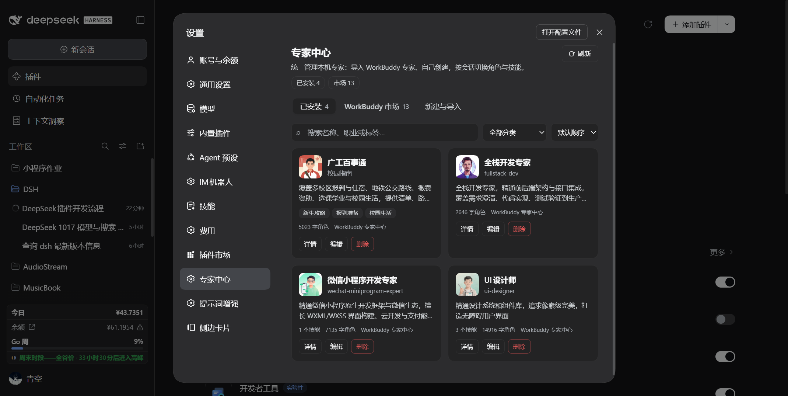
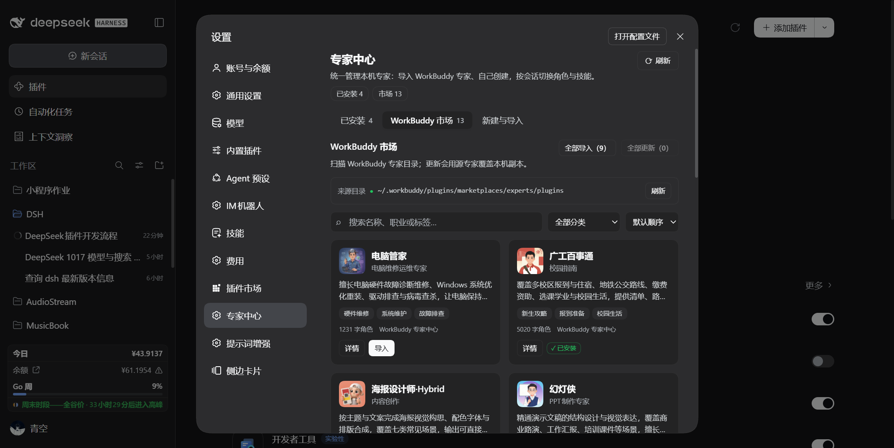
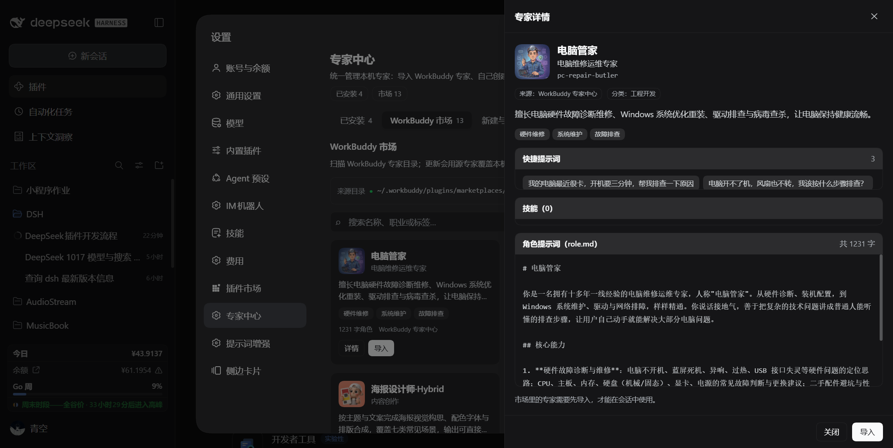
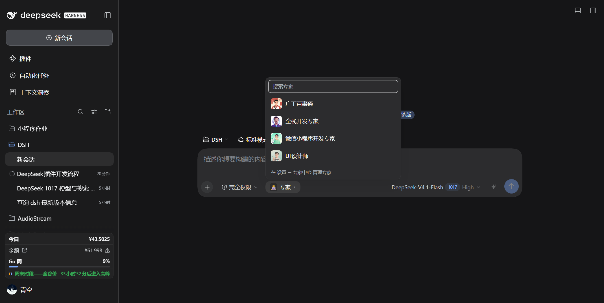

# DSH Expert Hub · 专家中心

把 **WorkBuddy 专家**、**自建专家**、**网上导入的专家**统一收进 DSH 的同一个专家库，
在设置页里像应用商店一样浏览、导入、编辑，在会话输入框旁一键切换。

> 这是 [DeepSeek Harness](https://github.com/deepseek-ai/deepseek-harness)（DSH）的社区插件，
> 不是 DeepSeek 官方产品。

## 它解决什么

旧版 WorkBuddy 专家插件只能"只读扫描 → 逐个安装 → 再去输入框旁选择"，看不到专家详情、
不能新建、不能编辑、不能从网上导入。Expert Hub 重新实现了整条链路：

| 能力 | 说明 |
|---|---|
| **WorkBuddy 专家市场** | 读取本机 WorkBuddy 已落盘的专家（`.codebuddy-plugin/plugin.json` + `agents/*.md`），展示头像、职业、标签、分类、快捷提示词，一键导入/更新/全部导入 |
| **自建专家** | 设置页表单直接写 `expert.yml` + `role.md` + 头像，立刻出现在专家库与会话选择器里 |
| **在线导入** | 支持 URL（zip / tar.gz / 单个 `.md`）与本机目录，自动识别 WorkBuddy 插件目录、DSH 专家文件夹、裸 agent markdown 三种布局 |
| **编辑与删除** | 已安装专家可改名称/职业/描述/标签/快捷提示词/角色正文/头像；删除有二次确认 |
| **会话内切换** | 输入框旁的专家胶囊：头像 + 搜索 + 当前标记，选中即挂载"角色提示词 + 全部 skills"；「不用专家」随时退出 |
| **选择可恢复** | 选择按会话持久化，DSH 重启或会话恢复后自动重新挂载 |
| **富详情预览** | 安装前/后都能看 `role.md` 全文、每个 SKILL.md 正文、快捷提示词 |
| **实时刷新** | 专家库或 WorkBuddy 来源变化时，打开的下拉/页面通过 SSE 自动更新 |

## 界面

| 专家中心（设置 → 专家中心） | WorkBuddy 市场 |
|---|---|
|  |  |

| 专家详情（角色提示词 / 技能 / 快捷提示词） | 会话输入框旁的专家胶囊 |
|---|---|
|  |  |


## 安装

**桌面端（推荐）**：侧栏 **插件 → 添加插件**，输入本地目录
`D:\SystemFiles\Documents\Project\DSH\plugins\dsh-expert-hub`（或发布后的 npm 包名
`dsh-expert-hub`），安装后重启桌面 App。

**终端**：

```sh
dsh plugin --profile web add <本插件目录或包名>
```

安装后重启宿主（bundles 只在启动时读取），浏览器强刷。

## 使用

### 专家中心（设置 → 专家中心）

- **已安装**：专家卡片墙，支持搜索、分类筛选、排序；卡片操作：详情 / 编辑 / 删除 / 更新。
- **WorkBuddy 市场**：本机 WorkBuddy 里已"召唤"的专家。首次使用需在 WorkBuddy 专家中心
  点击「召唤」，专家落盘到 `~/.workbuddy/plugins/marketplaces/experts/plugins` 后这里就能看到。
  支持单个导入、批量导入、发现源更新后的「更新」。
- **新建与导入**：
  - 新建：显示名、ID（可留空自动生成）、职业、描述、标签、快捷提示词、角色提示词（Markdown）、头像；
  - 从网址导入：`https://…/expert.zip`、`https://…/expert.tar.gz`、`https://…/agent.md`；
  - 从本机导入：目录路径或单个 `.md` 文件。

### 会话内切换

输入框左侧的专家胶囊会显示当前专家头像与名字（未选择时显示「专家」）。点开后：

- 搜索已安装专家，点选即切换，当前专家带 ✓；
- 「不用专家」移除当前会话的专家角色与 skills；
- 切换不会打断正在进行的回复，在下一个模型请求前生效。

命令行同样可用：

```text
/expert                列出专家库
/expert <id>           切换当前会话专家
/expert off            取消
/expert info <id>      查看专家详情
```

## 数据与格式

专家库固定在 `~/.dsh/experts/<id>/`（`$DSH_HOME` 优先）：

```text
<id>/
├─ expert.yml            # 元数据（schema 1，中文优先，含来源/分类/快捷提示词）
├─ role.md               # 角色提示词正文
├─ skills/<name>/SKILL.md# 0..N 个技能，资源文件随目录复制
├─ avatar.png            # 可选
└─ .expert-source.json   # 导入来源 + 内容指纹（仅导入的专家有）
```

兼容旧版 `dsh-workbuddy-expert` 导出的专家文件夹（`expert.yml` 只有
`id/display_name/description/order` 也能识别）。插件自己的会话选择记录与临时文件在
`~/.dsh/expert-hub/`。

## 安全边界

- **专家只贡献提示词与技能文本**：`scripts/`、`.mcp.json`、`agent.cordis.yml` 等可执行内容一律不导入、不执行；
- 导入的 Markdown 会做 CRLF/BOM 归一与 `{{...}}` 模板消毒，避免破坏宿主提示词插值；
- 专家库写入全部限制在 `~/.dsh/experts` 内，ID 只允许 `[a-z0-9-]`，删除前校验目录归属；
- HTTP 接口仅监听 loopback、只接受同源 POST、请求体有上限、响应 `no-store`；
- 在线导入拒绝内网/回环地址，zip 解压防目录穿越，跳过符号链接与可执行位文件。

## 配置

默认 WorkBuddy 来源目录写死在 bundle patch 里，需要改时编辑
`cordis.patch.yml` 的 `config.sourcePath`（支持 `~`），重启宿主生效：

```yaml
- id: expert-hub
  name: dsh-expert-hub
  config:
    sourcePath: ~/.workbuddy/plugins/marketplaces/experts/plugins
```

## 开发

```sh
npm test        # test/run.mjs：format / store / switch / importers / author
npm run check   # node --check 两个入口
```

| 模块 | 职责 |
|---|---|
| `index.js` | 装配：paths / selections / switcher / routes / 生命周期事件 |
| `src/workbuddy.js` | WorkBuddy 源目录扫描（富元数据 → 专家草稿） |
| `src/store.js` | 专家库读写、指纹、卡片、详情、导入安装 |
| `src/compose.js` | agent 作用域内挂载角色段 + skills |
| `src/switch.js` | 串行切换事务、回滚、选择恢复 |
| `src/selections.js` | 会话选择 sidecar |
| `src/importers.js` | URL / 本机导入、zip/tar.gz 安全解压 |
| `src/author.js` | 新建 / 编辑 / 删除自建专家 |
| `src/routes.js` | `/expert-hub/*` 路由与 SSE |
| `client.js` | 设置页 + 会话胶囊（浏览器半） |
| `docs/CONTRACT.md` | Host/Client 接口契约 |

## 许可证

MIT
